# Black Week Beast · 20 al 27 de noviembre de 2026

| 1,69 M | 55 pedidos | $169.900 | 60k/día |
|---|---|---|---|
| utilidad estimada de la semana, frente a 0,33 M en una semana normal | meta de la semana (36 en pack); hoy ≈ 15 | pack de entrada (3 prendas) | pauta durante 8 días |

**En 30 segundos**

- Packs fijos medidos contra el precio de lista (tachado): 3 prendas desde 169.900 y 4 prendas por 249.900 con envío gratis.
- El envío gratis solo aparece desde 249.900 (el precio del Pack 4). En los packs de 3 se comería la mitad del margen.
- La pauta empuja estáticos con precio grande y carruseles, el formato que mejor vende en nuestra cuenta. El video y el 3D ligero suman alcance.
- Del 20 al 27 de noviembre, cerrando en el Black Friday, con pauta de 60.000/día.
- Antes del 10-nov hay que reabastecer la oversized negra, la pantaloneta y la compresión.

## 4 packs en escalera; el envío gratis solo desde $249.900

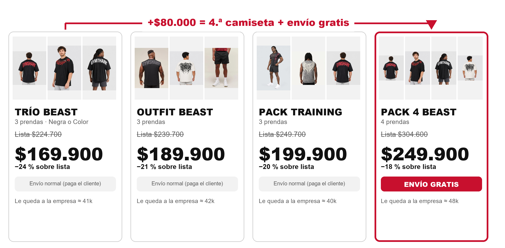

| Pack | Prendas | Lista | Precio | Desc. | Envío gratis | Le queda |
|---|---|---|---|---|---|---|
| Trío Negro | GYMSHARK Training Shirt + GYMSHARK NECKLACE Training Shirt + GMTHARK CBUM Training Shirt | $224.700 | $169.900 | 24 % | No | 41k |
| Trío Color | CHAOS TEE Training Shirt + ALL STARS TEE Training Shirt + BASIC TEE Training Shirt | $239.700 | $169.900 | 29 % | No | 40k |
| Outfit Beast | GS TANK Training Tank Top + CHAOS TEE Training Shirt + BASIC Gymshark Short | $239.700 | $189.900 | 21 % | No | 42k |
| Pack Training | GYMSHARK ICON Compress shirt + CHAOS TANK Training Tank Top + GYMSHARK Training Shirt | $249.700 | $199.900 | 20 % | No | 40k |
| Pack 4 Beast | GYMSHARK Training Shirt + GYMSHARK NECKLACE Training Shirt + GMTHARK CBUM Training Shirt + CHAOS TEE Training Shirt | $304.600 | $249.900 | 18 % | Sí | 48k |

**Complementos de liquidación:** ACID GRIS (CHAOS sobre acid gris claro) $39.900 (lista $69.900); Buzo compresión icon $59.900 (lista $89.900).

## El envío gratis en packs de 3 se come la mitad del margen

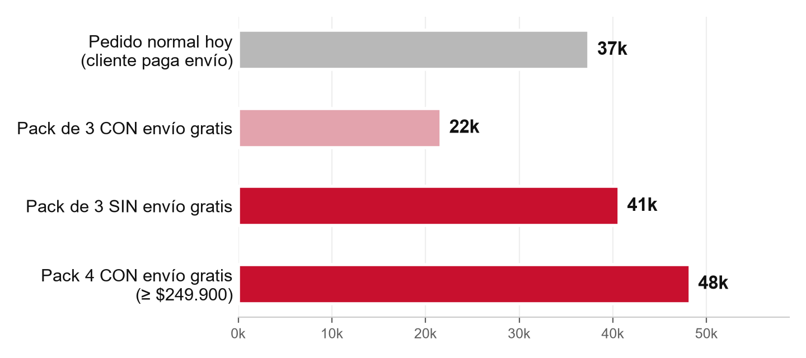

- Una vez pagadas las prendas, las comisiones y la nómina (10k por prenda), un pack de 3 con envío gratis deja ≈ **22k**: menos que un pedido normal (≈ 37k).
- Sin envío gratis, el mismo pack deja ≈ **41k**. El envío gratis se reserva para el Pack 4 ($249.900), que lo soporta (≈ 48k).
- Con 55 pedidos, la escalera deja **1,69 M** después de pauta. Con envío gratis en todo se necesitarían **71 pedidos** para igualarla.
- Para el cliente, el «antes» es el precio de lista (tachado), y el descuento se mide contra ese precio.

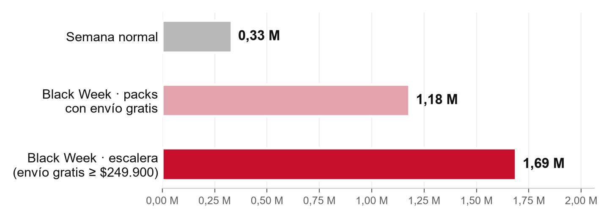

## En nuestra cuenta venden los estáticos con precio y los carruseles

Anuncios del 15 al 30 de octubre:

| Anuncio | Lectura |
|---|---|
| 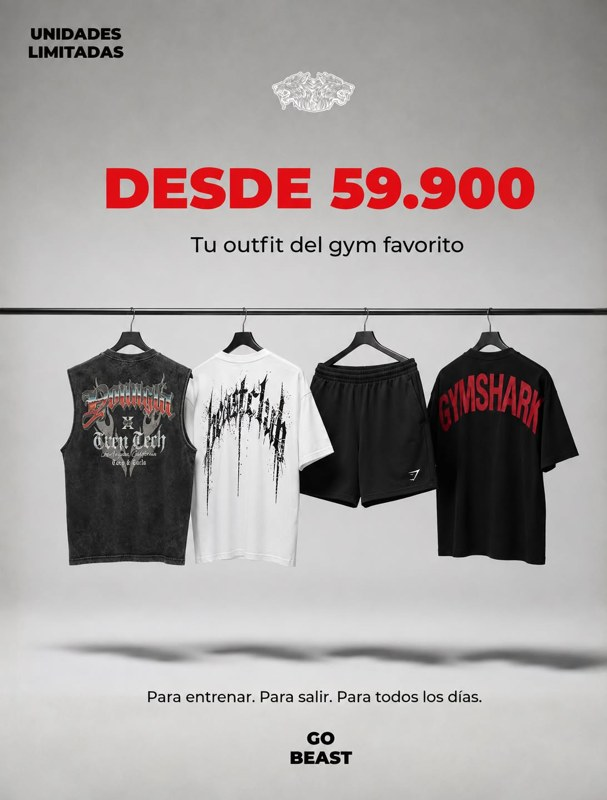 | **A5** · Estático · precio grande · CPA 9k · compra/visita 2,6 % · Motor de la cuenta |
| 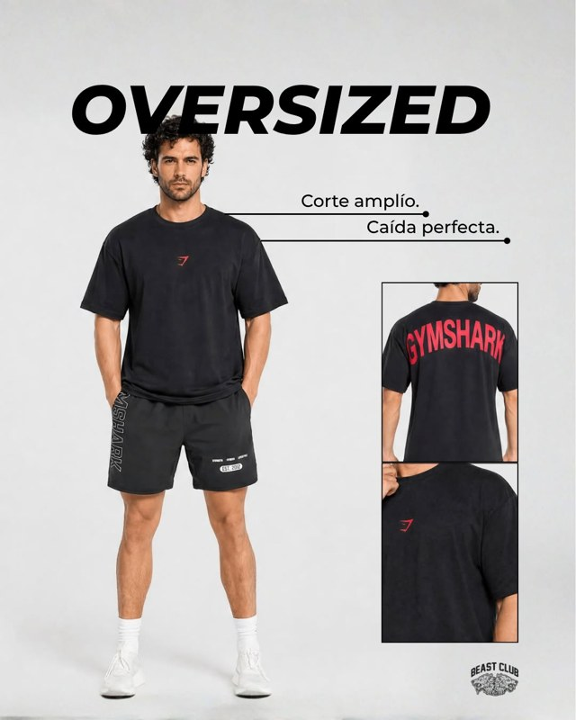 | **Banner** · Estático · pack «2 × 129.900» · CPA 8k · compra/visita 6,0 % · El pack ya funciona |
| 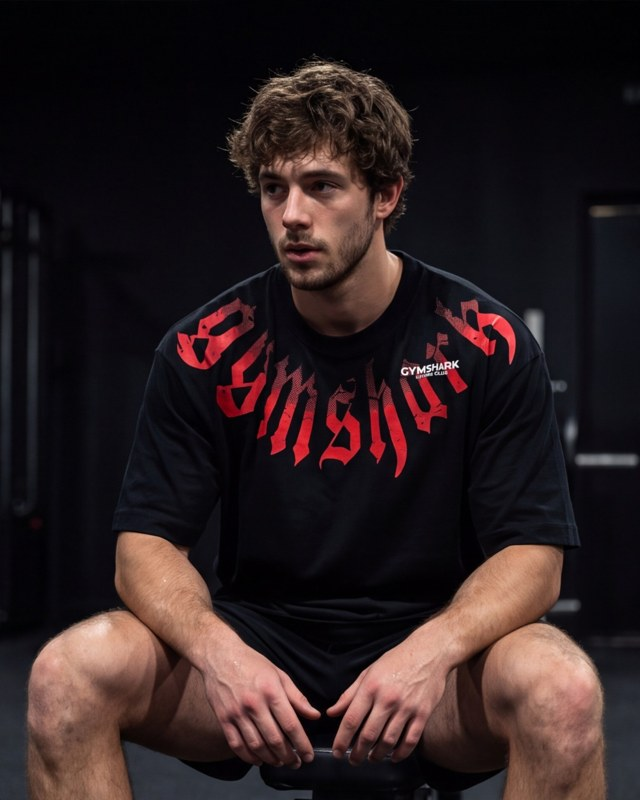 | **N2** · Carrusel de producto · CPA 4k · compra/visita 11,1 % · El CPA más bajo |
| 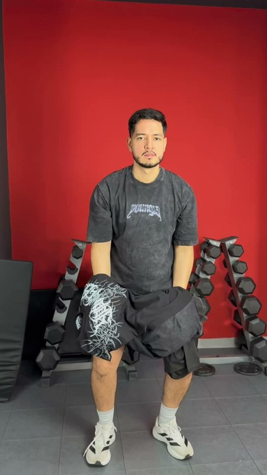 | **U2** · Video UGC · CPA 23k · compra/visita 0,6 % · Atrae (CTR alto), pero vende poco |

**Reglas que salen de la cuenta**

- El precio va grande y desde el primer segundo: los estáticos con precio son los que cierran la venta.
- Los packs se venden mejor en estático o carrusel. El video se usa para atraer y para retargeting.
- Los textos no nombran marcas, no dicen «nuevo lanzamiento» ni «robar», y el enlace va a la página de packs.

**Lo que dice la investigación**

- Andromeda (algoritmo de Meta) premia la diversidad real de conceptos. Con este presupuesto, 6–8 creativos distintos en un solo conjunto bastan. ([Jon Loomer · Andromeda](https://www.jonloomer.com/andromeda-3/))
- En Black Friday, la oferta debe verse en el primer segundo. Los estáticos con el descuento en grande siguen cerrando la mayoría de las conversiones. ([Triple Whale · BFCM](https://www.triplewhale.com/blog/bfcm-advertising-guide))
- En ropa de gym, el UGC lidera en atención si muestra fit y movimiento en un gym real. ([MHI · Meta Ads para activewear](https://mhigrowthengine.com/blog/meta-ads-for-activewear-brands/))
- El 3D/CGI da atención y recordación, pero no hay datos de que convierta mejor que el UGC: va como una sola prueba de bajo costo. ([Marketing Brew · FOOH](https://www.marketingbrew.com/stories/2023/10/26/why-some-brands-are-embracing-fake-out-of-home))

## 8 creativos: 6 de prospección y 2 de retargeting

| Clave | Segmento | Formato | Pack | Concepto | Gancho |
|---|---|---|---|---|---|
| E1 | Prospección | Estático 4:5 + 9:16 | TRÍO BEAST | Flat lay del Trío con precio gigante | 3 × $169.900 |
| E2 | Prospección | Estático 4:5 | PACK 4 BEAST | Escalera: 3 o 4, y la 4.ª trae envío gratis | ¿3 o 4? |
| C1 | Prospección | Carrusel 1:1 (5 tarjetas) | OUTFIT BEAST | Una tarjeta por prenda y cierre con el Pack 4 | Outfit completo $189.900 |
| V1 | Prospección | Reel UGC 9:16 · 8–12 s | TRÍO BEAST | 1 pack, 3 entrenos | 3 camisetas · $169.900 (en el segundo 0) |
| V2 | Prospección | 3D ligero 9:16 · 6–10 s | PACK 4 BEAST | Giro de 360° de las 4 camisetas (frente → espalda) | 4 × $249.900 · ENVÍO GRATIS |
| V3 | Prospección | Reel 9:16 · 10–12 s | PACK TRAINING | Calienta / Entrena / Pump | Kit training $199.900 |
| R1 | Retargeting | Estático 4:5 + 9:16 | PACK 4 BEAST | Cuenta regresiva | Quedan 2 días / Hoy es Black Friday |
| R2 | Retargeting | Carrusel 1:1 (4 tarjetas) | TRÍO BEAST | Los 4 packs, uno por tarjeta | Elige tu pack |

**Pauta:** Prospección Black Week 38k/día · Anuncio 5 (evergreen) 10k/día · Retargeting 12k/día.

| E1 | E2 |
|---|---|
| 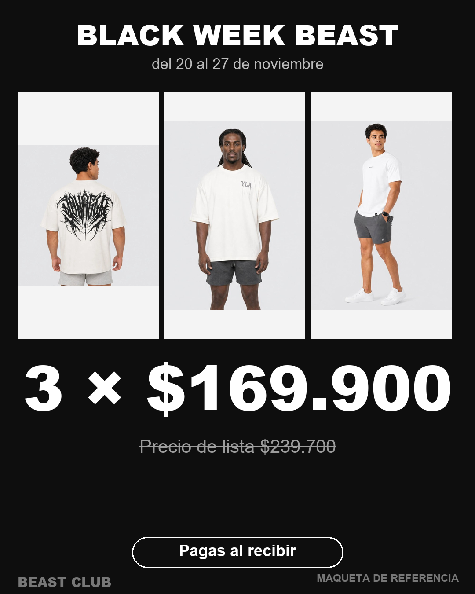 | 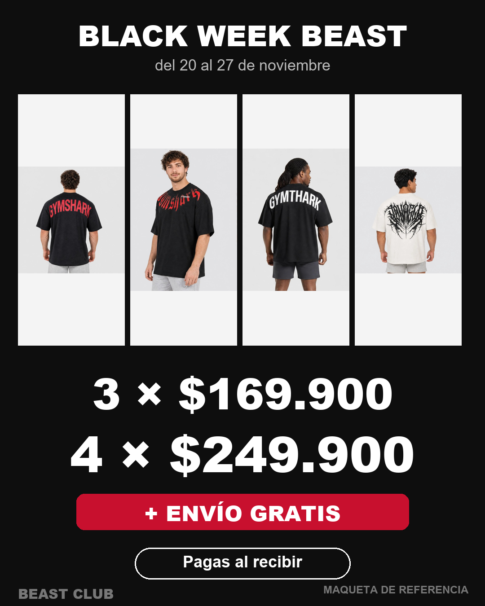 |

- Formatos: 4:5 de 1080×1350 (feed) y 9:16 de 1080×1920 (stories y reels). El carrusel va en 1:1.
- En 9:16 se deja libre de texto el 14 % de arriba y el 35 % de abajo.
- Precio legible en el móvil y el primer cuadro nunca en negro. Una idea por pieza.
- Siempre: logo de Beast Club, «Pagas al recibir» y el precio de lista tachado (nunca «antes»).

## La oferta en el primer segundo; el producto, cerca de la cámara

### V1 · 1 pack, 3 entrenos (Reel UGC 9:16 · 8–12 s)

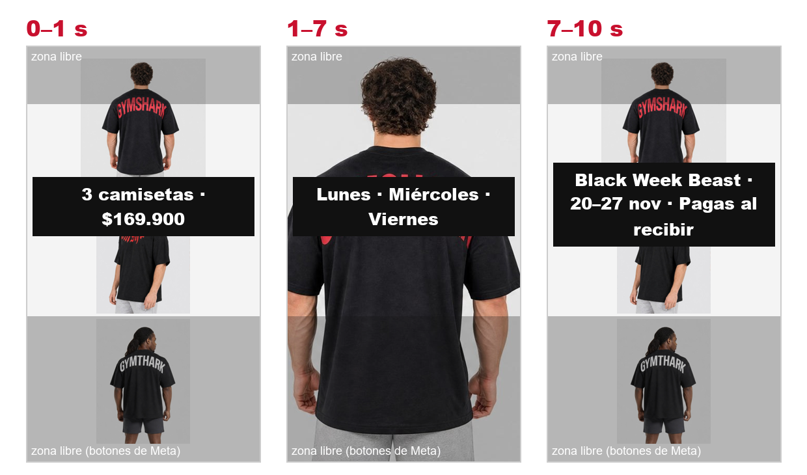

| Tiempo | Qué pasa |
|---|---|
| 0–1 s | Frente al espejo del gym, levanta las 3 camisetas. Texto: «3 camisetas · $169.900». |
| 1–7 s | Tres cambios al beat: «Lunes», «Miércoles», «Viernes». Plano medio, la prenda ocupa la mitad del cuadro. |
| 7–10 s | Las 3 dobladas. Texto: «Black Week Beast · 20–27 nov · Pagas al recibir». |

Tomas: Vertical 4K, luz del gym, sin cuadro negro al inicio; Cambios con salto de corte al beat (el mismo encuadre).

### V2 · Giro de 360° de las 4 camisetas (frente → espalda) (3D ligero 9:16 · 6–10 s)

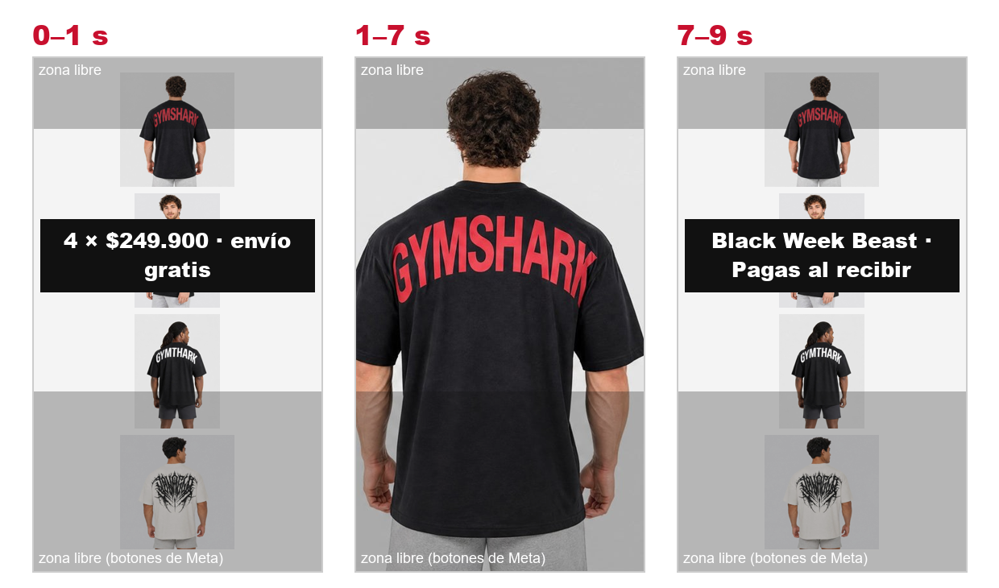

| Tiempo | Qué pasa |
|---|---|
| 0–1 s | La primera camiseta ya girando. Texto: «4 × $249.900 · envío gratis». |
| 1–7 s | Cada camiseta, 1,5 s girando de frente a espalda, cortes al beat. |
| 7–9 s | Las 4 juntas. Texto: «Black Week Beast · Pagas al recibir». |

Tomas: Base giratoria (o silla giratoria) con maniquí o percha rígida; Fondo negro mate, luz lateral, vertical 4K a 60 fps; Una vuelta completa en ~4 s por camiseta; acelerar en edición.

### V3 · Calienta / Entrena / Pump (Reel 9:16 · 10–12 s)

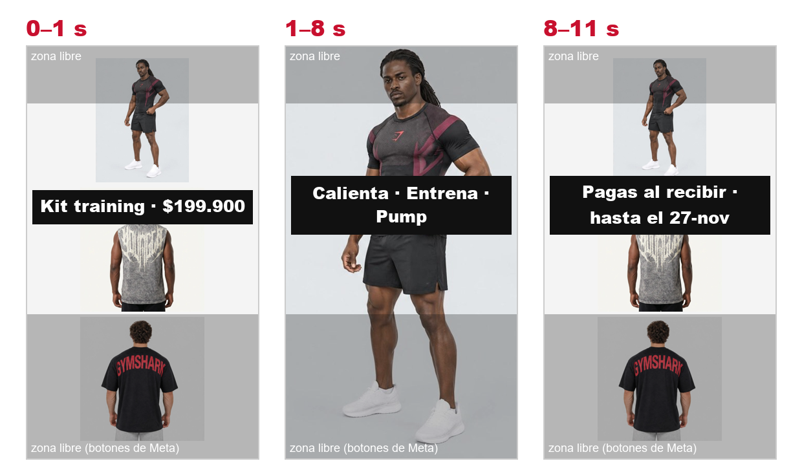

| Tiempo | Qué pasa |
|---|---|
| 0–1 s | Pump frente al espejo con la compresión. Texto: «Kit training · $199.900». |
| 1–8 s | «Calienta» con la oversized → «Entrena» con el tank (serie pesada) → «Pump» con la compresión. |
| 8–11 s | Las 3 prendas sobre el banco. Texto: «Pagas al recibir · hasta el 27-nov». |

Tomas: Tres planos cortos en el gym, el mismo atleta; Variante para el Outfit: «1 short, 2 looks».

## Reabastecer antes del 10-nov, lanzar el 20 y cerrar en Black Friday

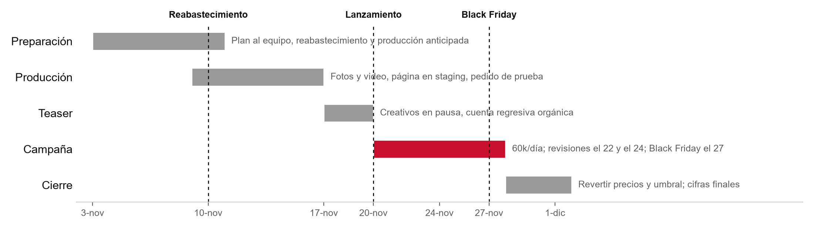

| Fase | Fechas | Qué pasa |
|---|---|---|
| Preparación | 11-03 → 11-10 | Plan al equipo, reabastecimiento y producción anticipada |
| Producción | 11-09 → 11-16 | Fotos y video, página en staging, pedido de prueba |
| Teaser | 11-17 → 11-19 | Creativos en pausa, cuenta regresiva orgánica |
| Campaña | 11-20 → 11-27 | 60k/día; revisiones el 22 y el 24; Black Friday el 27 |
| Cierre | 11-28 → 12-01 | Revertir precios y umbral; cifras finales |

| Correo | Asunto |
|---|---|
| 19-nov | Mañana empieza la Black Week Beast |
| 20-nov | 3 camisetas por $169.900 · 4 con envío gratis |
| 24-nov | ¿Ya armaste tu pack? |
| 27-nov | Black Friday: último día |

**Rotación:**

- Metas por creativo: gancho ≥ 25 % (video), CTR ≥ 1,5 %, carritos/visitas ≥ 10 % y CPA pixel ≤ 12k.
- Se pausa el creativo que gaste el doble del CPA sin compras.
- Revisiones el 22 y el 24 de noviembre con la skill meta-review. El 27 se cambia el texto de E1 y E2 a «Hoy es Black Friday».

## Reabastecimiento, metas y reglas

**Comprar antes del 10 de noviembre**

| Prenda base | Stock | Comprar | Por talla |
|---|---|---|---|
| Camiseta Oversized 200 gr - 011-Negro | 60 | 55 | S 1, M 13, L 20, XL 21 |
| Pantaloneta tela suave - 011-Negro | 5 | 12 | S 3, M 4, L 4, XXL 1 |
| Camiseta Oversized 200 gr - 001-Blanco | 30 | 7 | S 1, M 2, L 4 |
| Camiseta Oversized 200 gr - Hueso | 10 | 6 | S 1, M 1, L 2, XL 2 |
| Camiseta Compresión - Negra - Tiburón rojo | 7 | 5 | S 1, M 3, L 1 |

| Meta | Valor |
|---|---|
| Pedidos | 55 |
| Pedidos en pack | 36 |
| Utilidad después de pauta | 1,69 M |
| CPA real | ≤ 20k |

**Reglas de Meta**

- Sin marcas de terceros en textos ni en el texto de la imagen; el pack se nombra con su nombre Beast.
- Nada de «Nuevo lanzamiento» ni referencias a robo o ilegalidad.
- El precio tachado se presenta como «precio de lista». La SIC exige que ese precio se haya cobrado de verdad.
- El enlace va a la página de packs, nunca a la ficha de un producto con marca.
- Todo objeto nuevo se crea en PAUSA y se activa el 20-nov con el OK del dueño.

**Riesgos y pendientes**

- Marcas de terceros en Meta: la Versión Color va de primera en E1 y el enlace va a la página de packs. V2 y C1 muestran espaldas con logos de terceros: grabar también una versión con diseños propios (CHAOS, ALL STARS, BASIC TEE) por si Meta la rechaza.
- Que el tachado no se haya cobrado nunca (SIC): presentarlo como «precio de lista» y no como «antes».
- Capacidad de producción: producir por anticipado las tallas top antes del 20.
- Los pedidos con pack en Beast Hub: validar con un pedido de prueba antes de publicar.
- Corregir catálogo: ALL STARS figura «Hueso» en Beast Hub y «Vainilla» en Shopify; el buzo tiene el tachado menor que el precio; la compresión icon se titula YOUNGLA SUPERMAN.

**Página de packs (se implementa después)**

- Una página única de campaña, /pages/black-week-beast, como destino de todos los anuncios.
- Una tarjeta por pack: foto, talla por prenda, precio de lista tachado y precio del pack. El botón «Comprar ahora» lleva directo al pago.
- Junto al Trío, la mejora: «+80.000 = 4.ª camiseta + envío gratis».
- Envío gratis desde 249.900 durante la semana (no 250.000: el Pack 4 quedaría por fuera), con la barra del carrito alineada a ese monto.
- Mecanismo previsto: packs fijos con la app Shopify Bundles. Se valida con un pedido de prueba en Beast Hub.

## Copys listos para usar

| Clave | Título | Texto en la imagen | Copy | Destino |
|---|---|---|---|---|
| E1 | 3 camisetas por $169.900 | BLACK WEEK BEAST · 3 × $169.900 · Precio de lista $239.700 · Pagas al recibir | Black Week Beast: 3 oversized de 200 g por $169.900. Eliges la talla de cada una y pagas al recibir. Del 20 al 27 de noviembre. Lleva 4 y el envío es gratis. | /pages/black-week-beast#trio |
| E2 | 4 camisetas + envío gratis | 3 × $169.900 · 4 × $249.900 + ENVÍO GRATIS · Pagas al recibir | ¿3 o 4? En Black Week Beast llevas 3 oversized por $169.900, o 4 por $249.900 con envío gratis a toda Colombia. Pagas al recibir. Hasta el 27 de noviembre. | /pages/black-week-beast#pack4 |
| C1 | Outfit completo por $189.900 | 1: OUTFIT COMPLETO $189.900 · 2–4: cada prenda, frente y espalda · 5: ¿Mejor 4? $249.900 + envío gratis | Tank, oversized y short por $189.900. Cada prenda en tu talla y pagas al recibir. Black Week Beast, hasta el 27 de noviembre. | /pages/black-week-beast#outfit |
| V1 | 1 pack, 3 entrenos | 3 camisetas · $169.900 → Lunes / Miércoles / Viernes → Pagas al recibir | Tu semana de entreno resuelta: 3 oversized por $169.900 en Black Week Beast. Eliges cada talla y pagas al recibir. | /pages/black-week-beast#trio |
| V2 | 4 camisetas + envío gratis | 4 × $249.900 · ENVÍO GRATIS → Pagas al recibir | Cuatro oversized, frente y espalda, por $249.900 con envío gratis. Black Week Beast, hasta el 27 de noviembre. Pagas al recibir. | /pages/black-week-beast#pack4 |
| V3 | Kit training por $199.900 | Kit training $199.900 → Calienta / Entrena / Pump | Compresión, tank y oversized: el kit completo por $199.900 en Black Week Beast. Cada prenda en tu talla, pagas al recibir. | /pages/black-week-beast#training |
| R1 | Últimos días de Black Week | QUEDAN 2 DÍAS · 3 × $169.900 · 4 × $249.900 + envío gratis | Lo que viste ahora viene en pack: 3 por $169.900 o 4 por $249.900 con envío gratis. Pagas al recibir. Termina el 27 de noviembre. | /pages/black-week-beast |
| R2 | Elige tu pack | Trío $169.900 · Outfit $189.900 · Training $199.900 · Pack 4 $249.900 + envío gratis | Trío, Outfit, Training o Pack 4: elige el tuyo hasta el 27 de noviembre. Pagas al recibir. | /pages/black-week-beast |

_CTA de todos: «Comprar». Cifras del 2026-10-31 (`scripts/analytics/black-week.cjs`); documento generado con `scripts/marketing/black-week-doc.py`._
